# Assembly Instructions

This guide describes assembly of a Raspberry Pi based stepper motor control unit. It assumes basic soldering and electronics skills and does not explain general assembly techniques in detail.

## Compatibility and important warnings

The device has been tested with these motor drivers:

- OrientalMotor CRD5103P
- OrientalMotor RKD507-A (discontinued; substitute RKSD503-A)

A driver that accepts pulse signals from 3 V to 5 V should work. The setup uses two hardware PWM outputs: one for counter-clockwise (CCW) motion and one for clockwise (CW) motion. Raspberry Pi 5 hardware PWM is suitable for the required motor speeds; software PWM is too slow. This setup is unsuitable if you need more than two fast PWM signals.

> **Warning:** The OrientalMotor CRD503-KD is not compatible. Use the CRD5103P instead.

## Assembly

1. If you are using an SSD, connect it to the Raspberry Pi. Otherwise, insert the SD card.
2. Screw the Raspberry Pi to the touchscreen and connect it using a DSI cable. Depending on the touchscreen model, it may also need GND and 5 V through the GPIO. This guide assumes a DSI cable connection.

   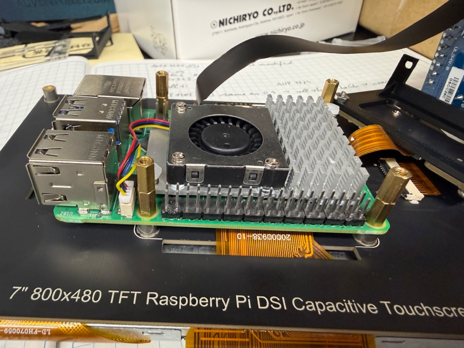

   *Figure 1. Raspberry Pi 5 screwed to the touchscreen; SSD on the right.*

3. Attach the MCC118 analog-to-digital (AD) board to the Raspberry Pi.

   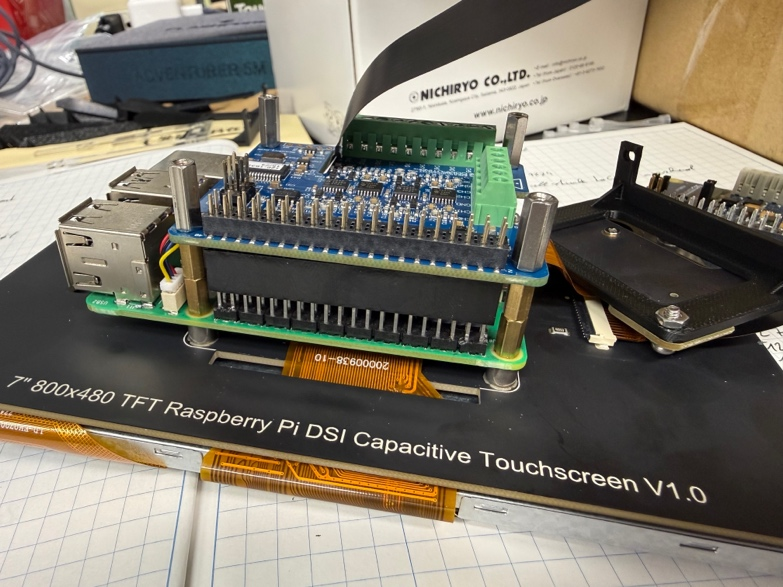

   *Figure 2. MCC118 AD board attached to the Raspberry Pi.*

4. Connect wires approximately 18 cm long to all MCC118 ports.

   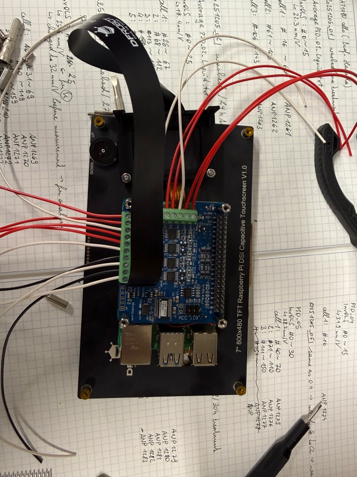

   *Figure 3. Wires connected to the AD board.*

5. Repeat for the MCC152 digital-to-analog (DA) board and tidy the wires.

   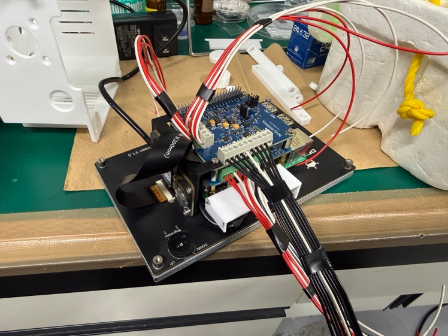

   *Figure 4. Wires connected to the AD and DA boards.*

6. (Optional) Attach the 3D printed cover for the USB-C and HDMI ports. It is cosmetic and can be omitted.

   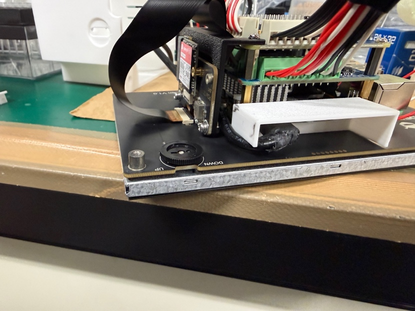

   *Figure 5. 3D printed cover for the USB-C and HDMI ports.*

7. Connect the AD and DA wires to BNC connectors on the back shell. The MCC118 has eight analog inputs (0–7), a clock input/output (CLK), and a trigger input (TRG). The MCC152 has two analog outputs (0 and 1) and eight digital outputs (DIO 0–7). Connect only the analog outputs to BNC connectors. Connect the digital outputs to the female 15-pin D-sub connector. The DIO ports are not currently used for standard operation, so connecting them is optional.

   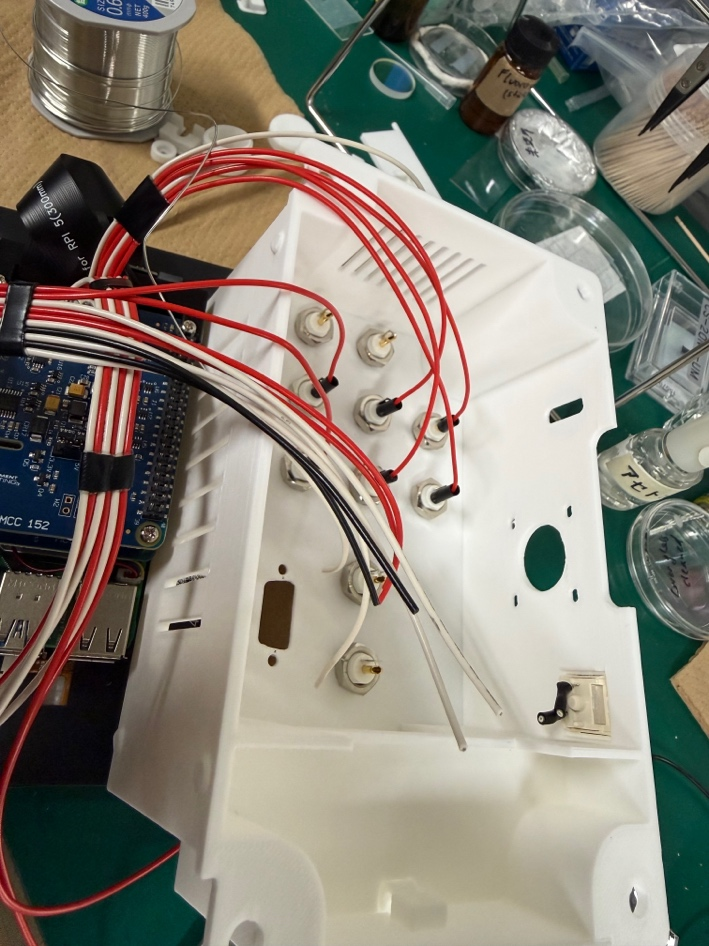

   *Figure 6. Connecting inputs and outputs to the case.*

   

   *Figure 7. D-sub connector pin assignment.*

8. Connect the PWM outputs: Raspberry Pi GPIO19 (physical pin 12) to D-sub position 1, and GPIO18 (physical pin 35) to D-sub position 5. The source instructions also specify +5 V and GND to D-sub positions 14 and 15, respectively.  **Verify the intended D-sub wiring before connecting power.** Raspberry Pi 5 +5 V is available on pins 2 and 4. GND is available on pins 6, 9, 14, 20, 25, 30, 34, and 39. Confirm pin assignments against official Raspberry Pi documentation.
9. Connect the buzzer to Raspberry Pi pin 11 (GPIO17) and any GND pin.
10. Connect a switch to the Raspberry Pi so the system can be switched on and off from the case. The guide assumes a Cherry MX style keyboard switch, but any switch that is normally off and on only while pressed will work. The 3D printed parts include an optional switch cap.

   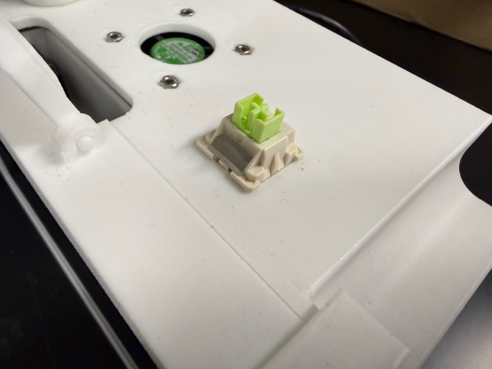

   *Figure 8. Mechanical keyboard switch for switching the system on and off.*

   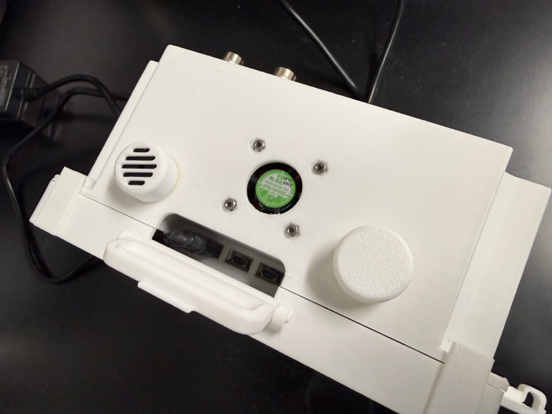

   *Figure 9. Optional cap attached to the switch.*

11. Add a buffer to raise the 3 V PWM output to 5 V, which the motor driver typically expects. Figure 10 shows an example using a Texas Instruments SNx4HC125 quadruple buffer. Follow the data sheet for the buffer you use. The buffer can be placed inside the case or directly before the motor driver. The CRD5103P may accept 3 V pulses, but its manual recommends 5 V.

   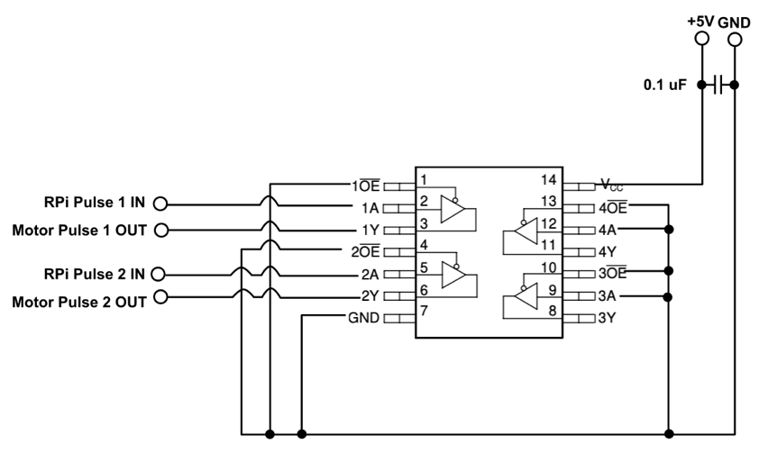

   *Figure 10. SNx4HC125 buffer circuit for raising 3 V PWM signals to 5 V.*

12. (Optional) Attach a case fan. Connect it to the Raspberry Pi cooler (use a four-wire fan), or connect it to the Raspberry Pi 5 GPIO or the MCC152 DIO and a GND connector. The software supports GPIO22 (physical pin 15), GPIO23 (physical pin 16), or DIO7.
13. Assemble the case. Figures 11–13 show the completed enclosure.

   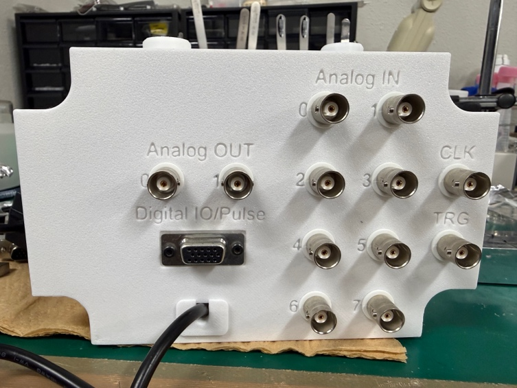

   *Figure 11. Back of the case.*

   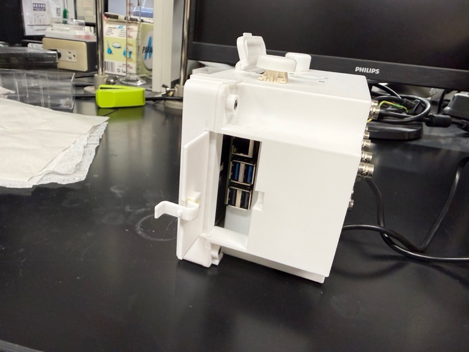

   *Figure 12. Side of the case with hatch open.*

   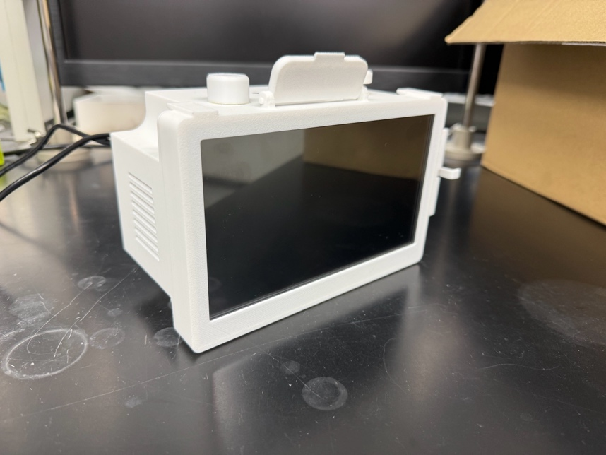

   *Figure 13. Front view of the assembled case.*

## 3D printable files

The [3D printable parts page](3D_printables/README.md) lists the STEP and FreeCAD models, quantities, part remarks, and recommended slicer settings.
