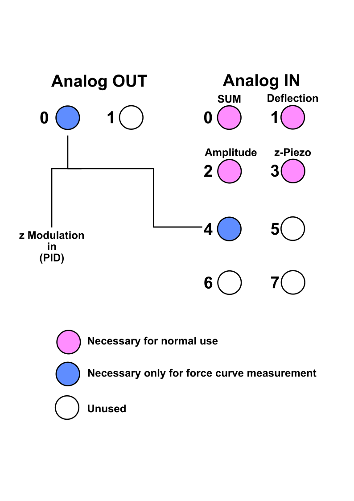

# Raspberry Pi Setup and I/O Guide

This guide describes the Raspberry Pi 5 PWM setup used by `motor_control.py`, the MCC DAQ HAT installation resources, and the signal assignments for this build. The assignments below are taken from the source code, assembly material, D-sub diagram, and BNC configuration diagram.

> **Wiring check:** CW / retract is assigned to D-sub position 1 and GPIO18 (physical pin 12); CCW / approach is assigned to D-sub position 5 and GPIO19 (physical pin 35). Confirm the connector mating-face orientation and the actual wiring before applying power.

## Install and launch the software

These steps are for a fresh Raspberry Pi OS installation. They install the project, create its virtual environment, build and install Digilent's DAQ HAT library, and launch the application. Both scripts automatically use `~/.venv`; you can optionally set `VENV_DIR` to use a different location. The environment uses `--system-site-packages` so it can also import system-installed `RPi.GPIO`.

1. Install Git, Python's virtual environment support, and the GPIO package:

   ```bash
   sudo apt update
   sudo apt install git python3-venv python3-rpi.gpio python3-pyqt5 python3-pyqt5.qtsvg
   ```

2. Clone this repository and create its virtual environment:

   ```bash
   cd ~
   git clone https://github.com/cganser/HSAFM-motor.git
   cd ~/HSAFM-motor
   ./setup_venv.sh
   ```

3. Clone, build, and install the Digilent DAQ HAT library. When prompted by the installer, choose Python 3 support:

   ```bash
   cd ~
   git clone https://github.com/mccdaq/daqhats.git
   cd ~/daqhats
   sudo ./install.sh
   ```

   The installer builds and installs the native library and detects the connected HAT EEPROMs, following Digilent's [official installation instructions](https://files.digilent.com/manuals/DAQ-HAT/install.html).

   Install the `daqhats` Python module into the virtual environment created in step 2:

   ```bash
   ~/.venv/bin/pip install daqhats
   ```

   This is separate from `sudo ./install.sh`: the installer builds the native DAQ HAT library, while this command installs the Python module into the app's virtual environment. Digilent also documents installing `daqhats` with the selected venv's `bin/pip` in its [library repository instructions](https://github.com/mccdaq/daqhats#install-instructions).

4. Return to the project and start the application:

   ```bash
   cd ~/HSAFM-motor
   ./run_motor_control.sh
   ```

   The launcher automatically uses `~/.venv` and sets the repository as the working directory so `settings.dat` is found. The Raspberry Pi 5 [hardware PWM overlay](#raspberry-pi-5-hardware-pwm) must be configured and the Pi rebooted before controlling the motor.

   To create a desktop shortcut from the repository folder, run:

   ```bash
   ./create_desktop_launcher.sh
   ```

   The script writes `~/Desktop/HSAFM-Motor.desktop` using the repository's actual path. If the desktop asks, right-click the new shortcut and choose **Allow Launching** or **Trust and Launch**.

   The Qt5 SVG bindings are supplied by the OS package `python3-pyqt5.qtsvg`; the project uses the OS PyQt5 modules so they match Raspberry Pi OS's Qt libraries. `PyQt5` is therefore intentionally not installed by pip from `requirements.txt`.

If you already cloned either repository, skip its `git clone` command and `cd` into the existing directory. To update the HSAFM application later, run `cd ~/HSAFM-motor && git pull`; rerun `./setup_venv.sh` if its Python requirements change.

## Raspberry Pi 5 hardware PWM

The application uses the Pi's hardware PWM outputs for the motor pulse signals. Software PWM is not suitable for the fast motor pulse rates used here.

1. Use Raspberry Pi OS on a Raspberry Pi 5.
2. Open the boot configuration file:

   ```bash
   sudo nano /boot/firmware/config.txt
   ```

3. Add this line at the end of the file:

   ```ini
   dtoverlay=pwm-2chan
   ```

4. Save the file and reboot:

   ```bash
   sudo reboot
   ```

5. After reboot, use `pinctrl get 18` and `pinctrl get 19` to confirm that the pins are assigned to PWM alternate functions. See the [Raspberry Pi `config.txt` documentation](https://www.raspberrypi.com/documentation/computers/config_txt.html) and the [Raspberry Pi overlay reference](https://github.com/raspberrypi/firmware/blob/master/boot/overlays/README).

The source creates the approach PWM with `pwm_channel=2`, the retract PWM with `pwm_channel=3`, and sets `chip=0`. Its header comment identifies the physical outputs as GPIO18 / physical pin 12 and GPIO19 / physical pin 35. The [`rpi_hardware_pwm` package](https://github.com/Pioreactor/rpi_hardware_pwm) must be available in the same Python environment used to launch the application. The PWM channel IDs in this project's code are not the BCM GPIO numbers.

> The code's `pwm_channel` values (2 and 3) and the library documentation's GPIO18/GPIO19 mapping should be verified together on the target Pi before connecting the motor driver. The code does not include a PWM pin loopback test.

## Install the MCC118 and MCC152 software

The MCC118 and MCC152 use the same MCC DAQ HAT software library. The official [MCC DAQ HAT documentation](https://files.digilent.com/manuals/DAQ-HAT/index.html) covers board installation, addresses, wiring, the C library, and Python. Useful sections include [installing one or more HAT boards](https://files.digilent.com/manuals/DAQ-HAT/hardware.html), [installing the library](https://files.digilent.com/manuals/DAQ-HAT/install.html), and the [MCC DAQ HAT library repository](https://github.com/mccdaq/daqhats).

### Hardware installation and addresses

1. Shut down and power off the Raspberry Pi before attaching or removing a HAT.
2. Fit the MCC boards using the stacking connectors and standoffs. Connect wires to the lower board before stacking a second board above it, because the screw terminals become difficult to reach.
3. Give each HAT in the stack a unique address using its A0–A2 jumpers. There must be a board at address 0; the recommended sequence is 0, 1, 2, and so on.
4. Reconnect power only after the boards are seated and secured.

See Digilent's [single-board and multiple-board mounting instructions](https://files.digilent.com/manuals/DAQ-HAT/hardware.html) for jumper and stacking diagrams.

### Install the DAQ HAT library

The vendor installation flow builds the native library and tools, detects the HAT EEPROMs, and can install the Python bindings. From a terminal on the Raspberry Pi, follow these commands from Digilent's [installation guide](https://files.digilent.com/manuals/DAQ-HAT/install.html):

```bash
sudo apt update
sudo apt install git python3-venv python3-rpi.gpio
cd ~
git clone https://github.com/mccdaq/daqhats.git
cd ~/daqhats
sudo ./install.sh
```

When prompted, choose Python 3 support. The project setup script creates its virtual environment with system site packages enabled, so it can use the vendor's system-installed `daqhats` bindings and system-installed `RPi.GPIO`. Install those hardware libraries for the system Python, then use the project scripts to install the remaining Python packages and launch the application.

Check that both boards are detected:

```bash
daqhats_list_boards
```

The software in this repository searches for one MCC118 and one MCC152 by board type and selects the first matching board. It initializes both HATs when the application starts. Although the main purchase list describes the MCC152 as conditional on force-curve use, the current source still requires the MCC152 to be present to launch.

The application also imports `RPi.GPIO`, `rpi_hardware_pwm`, `PyQt5`, `numpy`, and `matplotlib`. Install `RPi.GPIO` and PyQt5, including the QtSvg module, with `apt` as shown in the install steps. Run `./setup_venv.sh` from the repository to create `~/.venv` and install the remaining packages from `requirements.txt`, then launch with `./run_motor_control.sh`. The launcher uses the selected venv interpreter regardless of the source file's legacy shebang path.

If an existing environment reports `ImportError: cannot import name QtSvg from PyQt5`, install the OS packages, remove pip's PyQt5 copy from the venv if present, then verify the QtSvg import:

```bash
sudo apt install python3-pyqt5 python3-pyqt5.qtsvg
~/.venv/bin/pip uninstall -y PyQt5 PyQt5-Qt5 PyQt5-sip
~/.venv/bin/python -c 'from PyQt5 import QtSvg; print("QtSvg available")'
```

For board-specific capabilities and electrical limits, see the official [MCC DAQ HAT hardware overview](https://files.digilent.com/manuals/DAQ-HAT/overview.html) and [MCC152 product page](https://digilent.com/shop/mcc-152-voltage-output-and-dio-daq-hat-for-raspberry-pi/).

## BNC configuration

The diagram below is the supplied BNC configuration. Pink marks channels used during normal operation, blue marks connections used only for force-curve measurement, and white marks unused channels.



### MCC118 analog inputs

| MCC118 input | BNC label | Use in the application |
| --- | --- | --- |
| AI 0 | SUM | Normal operation; sum signal meter and auto-approach condition. |
| AI 1 | Deflection | Normal operation; deflection meter, force curve, and auto-approach condition. |
| AI 2 | Amplitude | Normal operation; amplitude meter and auto-approach condition. |
| AI 3 | z-Piezo | Normal operation; z-piezo meter and auto-approach condition. |
| AI 4 | z modulation in (PID) / force distance | Used for force-curve distance feedback; optional for normal operation. |
| AI 5 | — | Not assigned in the supplied configuration. |
| AI 6 | — | Not assigned in the supplied configuration. |
| AI 7 | — | Not assigned in the supplied configuration. |

The source defaults to AI channels 0–3 for SUM, deflection, amplitude, and z-Piezo. Its force-curve routine reads deflection on AI 1 and distance on AI 4. The MCC118 also provides CLK (bidirectional scan-clock terminal) and TRIG (external digital trigger input); the application does not configure either terminal.

### MCC152 analog outputs

| MCC152 output | BNC label | Use in the application |
| --- | --- | --- |
| AO 0 | z modulation in (PID) | Used by force-curve routines to drive the z modulation input; initialized to 2.5 V. The diagram marks this path as force-curve-only. |
| AO 1 | — | Initialized to 0 V and otherwise unassigned in the current source. |

The diagram shows AO 0 connected to the z-modulation input and the AI 4 force-distance monitor. The MCC152 is a two-channel 0–5 V DAC; the application uses AO 0 for the sweep and reads its measured response through MCC118 AI 4.

## Raspberry Pi GPIO and motor-driver D-sub

| Pi signal | BCM GPIO | Physical pin | Application assignment |
| --- | ---: | ---: | --- |
| Retract / CW PWM | GPIO18 | 12 | Hardware PWM pulse output; default retract channel. D-sub position 1. |
| Approach / CCW PWM | GPIO19 | 35 | Hardware PWM pulse output; default approach channel. D-sub position 5. |
| Buzzer | GPIO17 | 11 | Software-generated buzzer tones. Connect the other buzzer lead to GND. |
| Optional case fan | GPIO22 | 15 | On/off output option in Advanced settings. |
| Optional case fan | GPIO23 | 16 | On/off output option in Advanced settings. |
 |

The Advanced tab defaults the case fan control to MCC152 DIO7. GPIO fan options are GPIO22, GPIO23. These are on/off control signals, not PWM signals. The fan will always run at maximum speed.

The Cherry MX case switch is an external power button, not a GPIO input. Connect it as a normally-open momentary switch across the Raspberry Pi 5's J2 power-button pads. Briefly closing J2 invokes the same behavior as the onboard power button: on Raspberry Pi Desktop it opens the shutdown/reboot/logout prompt; pressing again initiates shutdown. See Raspberry Pi's [power button instructions](https://www.raspberrypi.com/documentation/hardware/raspberrypi/power.html#power-button).

### D-sub connector positions

The assembly D-sub diagram assigns the following signals. Number positions from the connector's mating face and confirm orientation against the connector before wiring.

| D-sub position | Signal |
| ---: | --- |
| 1 | CW / retract pulse from GPIO18 (physical pin 12) |
| 2–4 | Empty |
| 5 | CCW / approach pulse from GPIO19 (physical pin 35) |
| 6 | MCC152 DIO7 |
| 7 | MCC152 DIO6 |
| 8 | MCC152 DIO5 |
| 9 | MCC152 DIO4 |
| 10 | MCC152 DIO3 |
| 11 | MCC152 DIO2 |
| 12 | MCC152 DIO1 |
| 13 | MCC152 DIO0 |
| 14 | +5 V |
| 15 | GND |

The source defaults to two PWM pulse outputs. It also contains an alternate pulse-plus-direction code path with direction channel 0 (MCC152 DIO0), but the output-mode selector is commented out in the user interface. DIO0 is therefore not part of the normal two-PWM configuration. DIO1–DIO6 are not otherwise assigned in the current application; DIO7 is the default optional fan-control output.

## Signal summary

- **MCC118 inputs:** AI 0 SUM, AI 1 deflection, AI 2 amplitude, AI 3 z-Piezo, AI 4 force distance (force-curve path), AI 5–AI 7 unused. CLK and TRIG terminals are not used by the application.
- **MCC152 outputs:** AO 0 z modulation / force-curve sweep, AO 1 unused; DIO7 optional case fan by default. DIO0 is a code-path direction output only if the alternate mode is enabled; DIO1–DIO6 are otherwise unassigned.
- **Raspberry Pi outputs:** GPIO18 / physical pin 12 retract-CW PWM (D-sub 1); GPIO19 / physical pin 35 approach-CCW PWM (D-sub 5); GPIO17 / pin 11 buzzer; optional fan control GPIO22 / 23
- **External control:** the motor driver receives the pulse outputs from the D-sub connector; connect its ground/reference according to the motor-driver manual and the verified wiring diagram.
